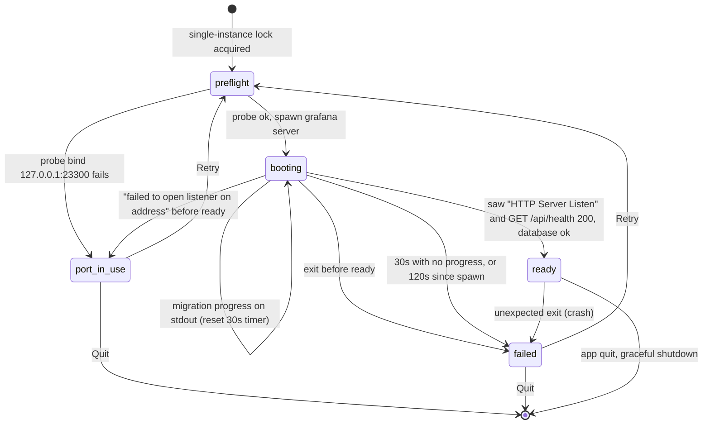

# Grafana Desktop: server spawn and health contract

Status: **signed off by Electron and Eng Manager** (CUR-28), except the product questions in [Pending Eng Manager decisions](#pending-eng-manager-decisions). Owner: Full Stack. Consumers: server process manager, startup/failure states page, theme sync spec, smoke definition, CI-4.

Typed constants for this contract (port, origin, timeouts, log markers, theme link patterns) will live at `desktop/src/shared/server-contract.ts`, inside Electron's scaffold branch (CUR-36). If that file and this doc disagree, this doc wins until the constants are updated.

This is the contract between Electron main and the bundled Grafana server. Electron main spawns the server as a child process and loads the SPA in a thin `BrowserWindow` at exactly `http://127.0.0.1:23300`. All configuration uses existing `GF_*` env vars or a generated `custom.ini`. **No `pkg/` changes are needed** (see [No `pkg/` changes](#no-pkg-changes)).

Source links point at `main`. Line numbers were verified at commit `e7b95c6dd5`.

## 1. Locked decisions

These are decided. This document records them and doesn't reopen them.

| Area         | Decision                                                                                                                                                                                                                                 |
| ------------ | ---------------------------------------------------------------------------------------------------------------------------------------------------------------------------------------------------------------------------------------- |
| Config       | `GF_*` env vars or a generated `custom.ini` under `app.getPath('userData')`. No `pkg/` changes.                                                                                                                                          |
| Bind         | `127.0.0.1` only. Never `localhost`, never `0.0.0.0`.                                                                                                                                                                                    |
| Port         | **`23300`**, approved by Eng Manager and Electron (section 2). One pinned port that fails loudly. **No fallback port in v1**: a different port is a different origin, which loses localStorage/IndexedDB and breaks OAuth redirect URIs. |
| `root_url`   | Exactly `http://127.0.0.1:<port>/`.                                                                                                                                                                                                      |
| Paths        | data, logs, plugins, and provisioning live under `userData`, never under the install dir.                                                                                                                                                |
| Session      | Persistent Electron partition `persist:grafana`. Logout clears it when the window navigates to `/logout` (separate ticket).                                                                                                              |
| Health       | `booting` → `ready` / `failed` / `port-in-use`. The 30 s booting timer resets on migration progress, with a 120 s hard limit (section 5).                                                                                                |
| Shutdown     | SIGTERM → grace → SIGKILL. No orphaned processes. On Windows, a hard tree-kill is accepted for v1; graceful Windows shutdown is a post-v1 follow-up (section 7).                                                                         |
| Theme signal | The preload watches the theme stylesheet `<link>` in `<head>` and sends `'light' \| 'dark'` on the one-way channel. No `public/` change. CI-4 asserts on the link `href` (section 9).                                                    |
| Crashes      | Always shown to the user, never silent.                                                                                                                                                                                                  |
| Instances    | `app.requestSingleInstanceLock()` plus an exclusive lock on the desktop data dir, so two copies never share one SQLite file. Orphaned servers are found through main's own child record (section 7).                                     |

## 2. Pinned port: `23300` (approved)

**`23300`, approved by Eng Manager and Electron.** Reasons:

- **Doesn't collide with the repo's own ports.** `23300` appears nowhere in the repo. The dev server uses `3000` ([`conf/defaults.ini#L50`][ini-http-port]). The devenv Grafana block maps `3001:3000` ([`devenv/docker/blocks/grafana/docker-compose.yaml#L4`][devenv-grafana]), which Playwright also uses ([`playwright.config.ts#L8`][pw-url]). Storybook e2e uses `9001` ([`package.json#L38`][storybook-port]). Webpack livereload uses `35750` ([`scripts/webpack/webpack.dev.js#L128`][livereload]). The devenv blocks use 3100, 3200, 4317/4318, 5432, 8080/8081, 9090–9112, and other common ports.
- **Avoids common dev ports**, including 3000–3010, 4200, 5000, 5173, 6006, 8000, 8080, 8888, and 9000.
- **Below every OS ephemeral range.** Linux uses 32768–60999, and Windows and macOS use 49152–65535. A random outbound socket can't take the port.
- **Outside the Kubernetes NodePort range** (30000–32767), which kind and minikube users often map to localhost.
- **Unassigned in the IANA registry** (checked against the current `service-names-port-numbers.csv`).

Residual risk: Windows can reserve arbitrary port blocks (`netsh int ipv4 show excludedportrange protocol=tcp`), for example when Hyper-V, WSL, or Docker is installed. In that case the bind fails with a permission error rather than "in use". Section 6 handles both cases as `port-in-use`, so the user still gets the Retry/Quit screen instead of a silent failure.

## 3. Configuration

### 3.1 Override mechanism (verified)

- **Env var naming:** `GF_<SECTION>_<KEY>`, uppercased, with `.` and `-` replaced by `_` ([`setting.go#L1078-L1091`][envkey]). For example, `[server] http_addr` maps to `GF_SERVER_HTTP_ADDR`.
- **Precedence**, lowest to highest ([`loadConfiguration`, `setting.go#L1193-L1235`][loadcfg]):
  1. `conf/defaults.ini` under `--homepath`
  2. `cfg:default.*` arguments
  3. The `--config` file
  4. `GF_*` env vars
  5. `cfg:<section>.<key>` arguments
- **Empty values are ignored**, both in the `--config` file ([`setting.go#L1173`][ini-empty]) and in env vars ([`setting.go#L861`][env-empty]). You can't blank out a key through either mechanism.
- **Relative paths resolve against `--homepath`**, which is the install dir ([`makeAbsolute`, `setting.go#L1145-L1150`][makeabs]; [`setting.go#L1246`][datapath], [`#L1419-L1423`][pluginspath], [`#L1777`][logspath]). **All path values must be absolute.**
- **When `--config` is passed, the install dir's `conf/custom.ini` isn't read** ([`setting.go#L1152-L1159`][loadspecified]).

> **Gotcha: inherited env wins over `custom.ini`.** If Electron is launched from a shell with `GF_*` set (for example `GF_SERVER_HTTP_PORT` from someone's dev setup), those values override our generated ini. Main **must build the child env explicitly and drop every inherited `GF_*` variable** (and `GF_INSTALL_PLUGINS*`, which is read directly in [`setting_plugins.go#L163`][install-plugins-env]). Then it sets only the contract's own values.

### 3.2 Binary and flags

- **Run `grafana server`, not `grafana-server`.** `grafana-server` is a deprecated shell wrapper that `exec`s `grafana server` ([`packaging/wrappers/grafana-server#L11-L12`][wrapper]). The real entrypoint is the `server` subcommand ([`pkg/cmd/grafana/main.go#L46-L49`][main-cmds]).
- Flags ([`pkg/cmd/grafana-server/commands/flags.go#L28-L54`][flags]):
  - `--homepath <installDir>`: the read-only install root that contains `conf/defaults.ini` and `public/`.
  - `--config <userData>/grafana/custom.ini`: the generated ini.
  - `--pidfile` isn't used. Grafana writes it only after migrations, so main doesn't trust it for orphan detection. Main keeps its own child record instead (section 7).
- **Don't use `--configOverrides` for paths.** It splits on spaces ([`cli.go#L96`][overrides-split]), and macOS `userData` is `~/Library/Application Support/...`. Positional `cfg:` arguments also exit the process if a value contains `=` ([`setting.go#L1134-L1137`][cfg-eq]).

Spawn shape:

```text
<installDir>/bin/grafana server \
  --homepath <installDir> \
  --config <userData>/grafana/custom.ini
```

### 3.3 Required keys

| Key ([`conf/defaults.ini`][ini])                 | Env var                 | Value                             | Default                                    |
| ------------------------------------------------ | ----------------------- | --------------------------------- | ------------------------------------------ |
| `[server] http_addr` ([L47][ini-http-addr])      | `GF_SERVER_HTTP_ADDR`   | `127.0.0.1`                       | empty, which binds all interfaces          |
| `[server] http_port` ([L50][ini-http-port])      | `GF_SERVER_HTTP_PORT`   | `23300`                           | `3000`                                     |
| `[server] domain` ([L53][ini-domain])            | `GF_SERVER_DOMAIN`      | `127.0.0.1`                       | `localhost`                                |
| `[server] root_url` ([L60][ini-root-url])        | `GF_SERVER_ROOT_URL`    | `http://127.0.0.1:23300/`         | `%(protocol)s://%(domain)s:%(http_port)s/` |
| `[paths] data` ([L17][ini-data])                 | `GF_PATHS_DATA`         | `<userData>/grafana/data`         | `data`                                     |
| `[paths] logs` ([L23][ini-logs])                 | `GF_PATHS_LOGS`         | `<userData>/grafana/logs`         | `data/log`                                 |
| `[paths] plugins` ([L26][ini-plugins])           | `GF_PATHS_PLUGINS`      | `<userData>/grafana/plugins`      | `data/plugins`                             |
| `[paths] provisioning` ([L29][ini-provisioning]) | `GF_PATHS_PROVISIONING` | `<userData>/grafana/provisioning` | `conf/provisioning`                        |

Notes:

- Set `root_url` as a literal. Don't rely on the `%(...)s` interpolation. The server appends a trailing `/` if it's missing ([`setting.go#L745-L761`][appurl]).
- The SQLite file is `[database] path = grafana.db`, resolved relative to `[paths] data` ([L200][ini-db-path]). So it lands at `<userData>/grafana/data/grafana.db`.
- `http_addr`, `http_port`, and `domain` are read in [`setting.go#L2220-L2222`][readserver]. The listen address is `net.JoinHostPort(http_addr, http_port)` ([`http_server.go#L451-L453`][joinhostport]).
- Main creates the four directories before spawning, plus `provisioning/{datasources,dashboards,plugins,alerting,access-control}` to mirror [`conf/provisioning/`][conf-prov]. A missing provisioning dir isn't fatal but logs an error on every boot ([`datasources/config_reader.go#L27-L31`][prov-missing]).

### 3.4 Recommended desktop defaults (all keys confirmed in `conf/defaults.ini`)

| Key                                                                       | Value                              | Why                                                                                                                                                                                                                                                                                |
| ------------------------------------------------------------------------- | ---------------------------------- | ---------------------------------------------------------------------------------------------------------------------------------------------------------------------------------------------------------------------------------------------------------------------------------- |
| `[server] enforce_domain` ([L57][ini-enforce])                            | `true`                             | Redirects any request whose `Host` isn't `127.0.0.1`, which blocks DNS-rebinding attacks from web pages against the local server ([`validate_host.go#L29-L48`][validate-host]). Runs after the health handlers, so polling is unaffected ([`http_server.go#L712-L723`][mw-order]). |
| `[analytics] reporting_enabled` ([L308][ini-reporting])                   | `false` (recommended)              | No usage stats from a desktop app without consent. **Pending Eng Manager's decision.**                                                                                                                                                                                             |
| `[analytics] check_for_updates` ([L318][ini-check-updates])               | `false`                            | Electron owns app updates. Grafana's banner would point users at the wrong installer.                                                                                                                                                                                              |
| `[analytics] check_for_plugin_updates` ([L325][ini-check-plugin-updates]) | `true` (keep)                      | Plugin updates are still installed in-app.                                                                                                                                                                                                                                         |
| `[plugins] preinstall_disabled` ([L2039][ini-preinstall-disabled])        | `true` (recommended by Electron)   | By default the server downloads five plugins from grafana.com in the background on every boot ([`setting_plugins.go#L35-L42`][preinstall-defaults], [`#L144-L150`][preinstall-apply]). `true` means no grafana.com reach-out on first boot. **Pending Eng Manager's decision.**    |
| `[security] cookie_secure` ([L424][ini-cookie-secure])                    | `false` (keep)                     | The origin is plain `http`.                                                                                                                                                                                                                                                        |
| `[security] cookie_samesite` ([L427][ini-cookie-samesite])                | `lax` (keep)                       | The default. `none` needs `Secure`, and `strict` breaks OAuth callbacks.                                                                                                                                                                                                           |
| `[security] secret_key` ([L394][ini-secret-key])                          | random, generated once per install | The default is a public constant used to encrypt data source secrets. Generate it on first run and **never rotate it**, because rotating makes existing secrets unreadable.                                                                                                        |
| `[log.console] format` ([L1200][ini-console-format])                      | `json`                             | Machine-parseable stdout for main (section 6). `[log] mode = console file` ([L1184][ini-log-mode]) stays as is, so file logs still go to `[paths] logs`.                                                                                                                           |

## 4. `/api/health`

Handler: [`apiHealthHandler`, `pkg/api/http_server.go#L781-L838`][health-handler]. Database check: [`pkg/api/health.go#L10-L25`][health-db].

- **Methods:** `GET` and `HEAD`, at exactly `/api/health`.
- **Auth:** none. It's registered as middleware before the context/auth handler ([`http_server.go#L712-L718`][mw-order]). CSRF checks are skipped for requests without a session cookie ([`csrf.go#L76-L82`][csrf]), so poll from main with Node `http`, not through the `persist:grafana` session.
- **200**, with `Content-Type: application/json`:

  ```json
  { "database": "ok", "version": "<x.y.z>", "commit": "<sha>" }
  ```

  `version` and `commit` are omitted if `[auth.anonymous] hide_version = true` ([L732][ini-hide-version]).

- **503:** the same JSON shape, with `"database": "failing"` when `SELECT 1` fails, and/or `"apiserver": "not ready"` while the embedded apiserver is still booting ([`http_server.go#L807-L827`][health-503]). **Treat 503 as "keep polling"**, not as failure.
- **The database result is cached for 5 s** ([`health.go#L23`][health-cache]). A transient failure can persist for up to 5 s.
- **Connection refused is normal while booting.** DB migrations run during dependency wiring ([`sqlstore.go#L71`][migrate]), before `Server.Run` starts the HTTP listener ([`server.go#L141-L150`][server-run]). On first boot (all migrations), the port isn't open at all, so the poll sees `ECONNREFUSED` rather than 503. Keep polling.
- `/healthz` always returns 200 when the web server is up and doesn't check the DB ([`http_server.go#L759-L770`][healthz]). **Don't use it for `ready`.**

## 5. State machine



| State         | Entry condition                                                                                                                                                                                       | Main does                                                                                                                                                                            |
| ------------- | ----------------------------------------------------------------------------------------------------------------------------------------------------------------------------------------------------- | ------------------------------------------------------------------------------------------------------------------------------------------------------------------------------------ |
| `booting`     | Pre-spawn probe passed and the child is spawned.                                                                                                                                                      | Polls `GET /api/health` about every 250 ms. Shows the splash.                                                                                                                        |
| `ready`       | **All three:** the child is alive, its stdout logged `HTTP Server Listen` with `address=127.0.0.1:23300` ([`http_server.go#L486`][listen-log]), and `/api/health` returned 200 with `database: "ok"`. | Loads `http://127.0.0.1:23300/` in the window.                                                                                                                                       |
| `failed`      | The child exits before `ready`, or a booting timeout fires (see [Booting timeouts](#booting-timeouts)), or the child exits after `ready` (crash).                                                     | Shows the startup page's failure state (section 10) with the exit code/signal, the last stdout lines, and the log path. Kills the child if it's still running. Never fails silently. |
| `port-in-use` | The pre-spawn probe fails, or stdout contains `failed to open listener on address` before `ready`.                                                                                                    | Shows the startup page's port-in-use state with Retry/Quit, handled in main (section 10). Doesn't spawn, or kills the child.                                                         |

### Booting timeouts

- **Idle timer: 30 s.** It starts at spawn and **resets whenever a migration progress line appears on the child's stdout**. If it expires, the state goes to `failed`.
- **Hard limit: 120 s from spawn.** Progress lines don't extend it. When it's reached, the state goes to `failed` even if migrations are still logging.
- **Progress lines** are the migrator's Info-level messages. Match on the message text, not the logger name, because the logger is `migrator` or `<scope>-migrator` ([`migrator.go#L107-L110`][migrator-logger]):
  - `Starting DB migrations` ([`migrator.go#L247`][migrator-start])
  - `Executing migration` ([`#L363`][migrator-exec])
  - `Migration successfully executed` ([`#L403`][migrator-ok])
  - `migrations completed` ([`#L307`][migrator-done])
- With `[log.console] format = json` (section 3.4), these appear as the `msg` field. Info is the default level ([`conf/defaults.ini#L1187`][ini-log-level]), so they're emitted without extra config.
- After `migrations completed`, the last 30 s window covers init provisioning and the listener opening.

**Why `ready` requires the listen log line:** if another process (for example a dev Grafana) is already serving `127.0.0.1:23300`, its `/api/health` returns 200 while our child is still migrating. Without the log-line check (and the pre-spawn probe), main would declare `ready` against the wrong server.

## 6. Port-in-use detection

Verified from source. Not run, because no server binary was built for this doc.

- **Error text:** `getListeners` returns `failed to open listener on address 127.0.0.1:23300: <os error>` ([`http_server.go#L552-L555`][listen-err]). The `<os error>` part depends on the OS:
  - Linux/macOS: `listen tcp 127.0.0.1:23300: bind: address already in use`
  - Windows: `... bind: Only one usage of each socket address ... is normally permitted.` A reserved port gives `... forbidden by its access permissions.` instead.
- **Which stream:** the failure is logged as `Module failed` with `err=<text>` ([`pkg/modules/listener.go#L44`][module-failed]). The error then propagates out of `Server.Run`, and `main` prints `Error: ✗ <text>` and exits with code **1** ([`main.go#L27-L30`][main-exit]). **Both go to stdout, not stderr**: the console logger writes to `os.Stdout` ([`log.go#L472`][log-stdout]), and `main` uses `fmt.Printf`.
- **Exit code 1 isn't specific.** Every startup error exits with 1. Main must match the Grafana-owned prefix `failed to open listener on address` on stdout, which is OS-independent. Treat any match as `port-in-use`, covering both "in use" and "reserved".
- **Timing problem:** the listener opens only after migrations and init provisioning (section 4). On first boot, the bind error can arrive many seconds after spawn.
- **Reliable method: a pre-spawn bind probe.** Main runs `net.createServer().listen({ host: '127.0.0.1', port: 23300, exclusive: true })`, then closes it immediately. `EADDRINUSE` or `EACCES` means `port-in-use` right away, with no spawn and no migration wait. The race window between closing the probe and Grafana's bind is negligible, and the stdout match covers it.

## 7. Shutdown and crashes

- **POSIX:** SIGTERM → wait **10 s** → SIGKILL. Grafana handles SIGTERM/SIGINT with a graceful shutdown bounded at 30 s ([`cli.go#L148-L170`][signals]). Spawn with `detached: true` so the server and its backend plugin processes share a process group. Kill with `process.kill(-pid, sig)` so plugin children don't outlive the server.
- **Windows:** Node can't deliver a graceful signal. `child.kill('SIGTERM')` terminates the process abruptly. Use a tree-kill (`taskkill /pid <pid> /T /F`) so plugin processes die too. **A hard tree-kill is accepted for v1.** SQLite's default rollback journal (`[database] wal = false`, [L206][ini-wal]) survives it, but in-flight writes are lost. Graceful Windows shutdown is a post-v1 follow-up.
- **Crash after `ready`:** any exit that main didn't request moves to `failed` with a visible screen. There's no silent restart loop in v1.

### Orphaned servers

**Main must not trust Grafana's pidfile.** Grafana writes `--pidfile` in `Server.Init` ([`server.go#L123`][pidfile]), which runs after dependency wiring has already run migrations. `sqlstore.ProvideService` is wired before `server.New` ([`wire_gen.go#L330`][wire-sqlstore], [`#L992`][wire-server-new]). If Electron crashes during first-boot migrations, the orphaned server keeps running with no pidfile.

Rules:

1. **Two locks.** Main keeps `app.requestSingleInstanceLock()`, and also takes an exclusive lock on the desktop data dir, for example `<userData>/grafana/desktop.lock`. The data-dir lock covers anything that bypasses Electron's instance lock, such as a second build or channel pointed at the same `userData`.
2. **Child record.** Main writes its own record, `<userData>/grafana/child.json` with `{ pid, spawnedAt }`, **the instant `spawn` returns**, before any migration runs. Write to a temp file, then rename. Main deletes the record after a clean exit that it requested.
3. **Next launch.** After taking both locks and before spawning, main reads the record:
   - If the pid is alive, is our `grafana` binary with our `--homepath` and `--config` on its command line, and its process start time matches `spawnedAt`, main tree-kills it (as above) and waits for it to exit.
   - Otherwise the pid is gone or was reused, so main deletes the stale record.
   - Then main runs the port probe and spawns.

**Why the lock alone isn't enough:** the OS releases a lock held by main when main crashes. The orphaned child keeps running on `grafana.db`, so the next launch gets the lock and would spawn a second server on the same SQLite file. The orphan may still be migrating and may not have bound `23300` yet, so the port-in-use probe won't catch it either. Only the child record, written before migrations start, identifies the orphan.

## 8. OAuth/SSO redirect URIs

- Generic and built-in OAuth connectors build the redirect URI as `strings.TrimSuffix(AppURL, "/") + "/login/" + <provider>` ([`connectors/common.go#L141`][oauth-redirect], [`social.go#L38`][social-base]). `AppURL` is `root_url` ([`setting.go#L2168-L2173`][readserver-appurl]).
- So every IdP app must register exactly `http://127.0.0.1:23300/login/<provider>`, for example `/login/github`, `/login/google`, `/login/generic_oauth`, `/login/azuread`, `/login/okta`, or `/login/gitlab`. Use the literal IP. `localhost` is a different string, and most IdPs match exactly.
- Changing the port or `root_url` invalidates every registered redirect URI. This is the main reason there's no fallback port.
- Some IdPs reject plain `http` redirects to anything other than `localhost`, or only allow loopback IP redirects for "native app" client types. That's a per-provider check, pending Eng Manager's decision on which providers v1 supports.

## 9. Theme signal (contract surface, guarded by CI-4)

**Decision:** the preload watches the theme stylesheet `<link>` in `<head>`. Its `href` contains `build/grafana.dark` or `build/grafana.light`. The preload sends `'light' | 'dark'` to main on the one-way channel. **There is no `public/` change.** **CI-4 asserts on the link `href`.**

- **How:** observe `<head>` child-list mutations. On each change, the preload resolves the mode from the **first** `link[href*="build/grafana.dark"]` or `link[href*="build/grafana.light"]` in `<head>`, and sends only when the mode changes.
- **Why the first link:** `changeTheme` inserts the new link at `head.firstChild` ([`theme.ts#L35`][theme-insert]). It removes the old link only in the new link's `onload` ([`theme.ts#L21-L34`][theme-onload]; whole block [`#L17-L36`][theme-swap]). So both links briefly coexist, and the first match is always the newest.
- **`nativeTheme.themeSource` is never set by main in v1.** Setting it overrides `prefers-color-scheme` inside the window. Grafana's `system` theme resolves through that media query ([`getSystemPreferenceTheme`, `packages/grafana-data/src/themes/registry.ts#L102-L106`][system-pref-theme]). Main would set the source, Grafana would follow it, and the preload would report it back, creating a feedback loop. The cached theme from the preload drives only the window `backgroundColor` and the startup page.
- **Why the link is a stable surface:** `changeTheme` itself finds the old stylesheet by that substring ([`theme.ts#L27`][theme-link]), and the `system` boot path inserts a link with the same asset URLs ([`index.html#L286-L304`][index-system]).
- **Rejected: watching the `<body>` class.** It doesn't update on a live toggle, and it can carry both classes under `system`. The findings follow.

- **Server render:** [`public/views/index.html#L43`][index-body] renders `<body class="theme-[[ .ThemeType ]] [[.AppNameBodyClass]]">`. `ThemeType` is the resolved theme's `Type` ([`pkg/api/index.go#L139`][index-theme], [`#L175`][index-themetype]), which is always `dark` or `light` ([`themes_generated.go#L6-L24`][themes]). `AppNameBodyClass` is `app-grafana` ([`index.go#L188`][index-appname]).
- **`system` theme:** `system` has `Type: "dark"` ([`themes_generated.go#L8`][themes-system]), so the server renders `theme-dark`. The inline boot script then tries to remove `theme-system`, which was never added, and adds `theme-dark` or `theme-light` based on `prefers-color-scheme` ([`index.html#L286-L304`][index-system]). **With `system` and a light OS, `<body>` ends up with both `theme-dark` and `theme-light`.** The script runs once at startup only ([`index.html#L286-L287`][index-system]).
- **Live change:** [`changeTheme`, `public/app/core/services/theme.ts#L9-L51`][change-theme] publishes `ThemeChangedEvent` and swaps the theme stylesheet `<link>`. It **doesn't touch `document.body.classList`**. The only other body-class writer on navigation is route `pageClass` handling ([`GrafanaRoute.tsx#L94-L102`][route-classes]), which is unrelated.

## 10. Startup page actions

- **Where it lives:** the startup and failure page is bundled in `desktop/resources/startup/`. Main loads it from disk, **never from `127.0.0.1`**, so it works when the server is down and never shares the SPA's origin.
- **No scripts** beyond reading a query param, which selects the state to show (for example `booting`, `failed`, or `port-in-use`).
- **Controls are plain links:** Retry is `<a href="grafana-desktop://retry">`, and Quit is `<a href="grafana-desktop://quit">`.
- **Scheme handling:** main handles `grafana-desktop` only in-process, through `protocol.handle` plus `will-navigate`. **Main never calls `app.setAsDefaultProtocolClient` and never registers the scheme with the OS**, so the OS never shows an open-external-app prompt and other apps can't launch these URLs. Retry moves to `preflight` and Quit exits (section 5).
- **Detail text:** detail appears only on the `failed` screen. It's the last stdout line, set with `textContent` (never `innerHTML`) and capped at about 200 characters. There's no live progress line in v1.
- **Honored only on the startup page:** main acts on these two URLs only while the window is showing the bundled startup page. Once the SPA is loaded, main blocks them and does nothing. A dashboard HTML panel or any other SPA content can't quit or restart the app.
- **IPC stays at v0.** These actions use navigation, not new IPC channels.

## No `pkg/` or `public/` changes

Everything in sections 1–10 uses existing keys, flags, endpoints, and DOM. Nothing here requires editing `pkg/` or `public/`. The one thing config can't do, graceful shutdown on Windows, is a post-v1 follow-up rather than a code change now.

## Resolved at sign-off

| Question                 | Resolution                                                                                                      |
| ------------------------ | --------------------------------------------------------------------------------------------------------------- |
| Theme signal             | Preload watches the `<head>` stylesheet link; no `public/` change; CI-4 asserts on the link `href` (section 9). |
| Pinned port              | `23300`, approved by Eng Manager and Electron (section 2).                                                      |
| First-boot ready timeout | 30 s idle timer that resets on migration progress, with a 120 s hard limit (section 5).                         |
| Windows shutdown         | Hard tree-kill accepted for v1; graceful Windows shutdown is a post-v1 follow-up (section 7).                   |

## Pending Eng Manager decisions

These are product questions. They don't block the process manager, because each one is a config value or an external setup step.

1. **Plugin preinstall:** Electron recommends `[plugins] preinstall_disabled = true` ([L2039][ini-preinstall-disabled]), so there's no grafana.com reach-out on first boot (section 3.4). Offline first runs reach `ready` either way; with preinstall on, they log download errors.
2. **Identity providers:** which IdPs v1 supports, and whether each accepts an `http://127.0.0.1:23300/login/<provider>` redirect (section 8).
3. **First login on a single-user desktop:** keep `admin`/`admin` with the forced password change, or provision the first user another way.
4. **Analytics:** confirm `[analytics] reporting_enabled = false` as the desktop default (section 3.4).

[ini]: https://github.com/mmlmike010/grafana/blob/main/conf/defaults.ini
[ini-data]: https://github.com/mmlmike010/grafana/blob/main/conf/defaults.ini#L17
[ini-logs]: https://github.com/mmlmike010/grafana/blob/main/conf/defaults.ini#L23
[ini-plugins]: https://github.com/mmlmike010/grafana/blob/main/conf/defaults.ini#L26
[ini-provisioning]: https://github.com/mmlmike010/grafana/blob/main/conf/defaults.ini#L29
[ini-http-addr]: https://github.com/mmlmike010/grafana/blob/main/conf/defaults.ini#L47
[ini-http-port]: https://github.com/mmlmike010/grafana/blob/main/conf/defaults.ini#L50
[ini-domain]: https://github.com/mmlmike010/grafana/blob/main/conf/defaults.ini#L53
[ini-enforce]: https://github.com/mmlmike010/grafana/blob/main/conf/defaults.ini#L57
[ini-root-url]: https://github.com/mmlmike010/grafana/blob/main/conf/defaults.ini#L60
[ini-db-path]: https://github.com/mmlmike010/grafana/blob/main/conf/defaults.ini#L200
[ini-wal]: https://github.com/mmlmike010/grafana/blob/main/conf/defaults.ini#L206
[ini-reporting]: https://github.com/mmlmike010/grafana/blob/main/conf/defaults.ini#L308
[ini-check-updates]: https://github.com/mmlmike010/grafana/blob/main/conf/defaults.ini#L318
[ini-check-plugin-updates]: https://github.com/mmlmike010/grafana/blob/main/conf/defaults.ini#L325
[ini-secret-key]: https://github.com/mmlmike010/grafana/blob/main/conf/defaults.ini#L394
[ini-cookie-secure]: https://github.com/mmlmike010/grafana/blob/main/conf/defaults.ini#L424
[ini-cookie-samesite]: https://github.com/mmlmike010/grafana/blob/main/conf/defaults.ini#L427
[ini-hide-version]: https://github.com/mmlmike010/grafana/blob/main/conf/defaults.ini#L732
[ini-log-mode]: https://github.com/mmlmike010/grafana/blob/main/conf/defaults.ini#L1184
[ini-log-level]: https://github.com/mmlmike010/grafana/blob/main/conf/defaults.ini#L1187
[ini-console-format]: https://github.com/mmlmike010/grafana/blob/main/conf/defaults.ini#L1200
[ini-preinstall-disabled]: https://github.com/mmlmike010/grafana/blob/main/conf/defaults.ini#L2039
[conf-prov]: https://github.com/mmlmike010/grafana/tree/main/conf/provisioning
[envkey]: https://github.com/mmlmike010/grafana/blob/main/pkg/setting/setting.go#L1078-L1091
[env-empty]: https://github.com/mmlmike010/grafana/blob/main/pkg/setting/setting.go#L861
[cfg-eq]: https://github.com/mmlmike010/grafana/blob/main/pkg/setting/setting.go#L1134-L1137
[makeabs]: https://github.com/mmlmike010/grafana/blob/main/pkg/setting/setting.go#L1145-L1150
[loadspecified]: https://github.com/mmlmike010/grafana/blob/main/pkg/setting/setting.go#L1152-L1159
[ini-empty]: https://github.com/mmlmike010/grafana/blob/main/pkg/setting/setting.go#L1173
[loadcfg]: https://github.com/mmlmike010/grafana/blob/main/pkg/setting/setting.go#L1193-L1235
[datapath]: https://github.com/mmlmike010/grafana/blob/main/pkg/setting/setting.go#L1246
[pluginspath]: https://github.com/mmlmike010/grafana/blob/main/pkg/setting/setting.go#L1419-L1423
[logspath]: https://github.com/mmlmike010/grafana/blob/main/pkg/setting/setting.go#L1777
[appurl]: https://github.com/mmlmike010/grafana/blob/main/pkg/setting/setting.go#L745-L761
[readserver-appurl]: https://github.com/mmlmike010/grafana/blob/main/pkg/setting/setting.go#L2168-L2173
[readserver]: https://github.com/mmlmike010/grafana/blob/main/pkg/setting/setting.go#L2220-L2222
[install-plugins-env]: https://github.com/mmlmike010/grafana/blob/main/pkg/setting/setting_plugins.go#L163
[preinstall-defaults]: https://github.com/mmlmike010/grafana/blob/main/pkg/setting/setting_plugins.go#L35-L42
[preinstall-apply]: https://github.com/mmlmike010/grafana/blob/main/pkg/setting/setting_plugins.go#L144-L150
[wrapper]: https://github.com/mmlmike010/grafana/blob/main/packaging/wrappers/grafana-server#L11-L12
[main-cmds]: https://github.com/mmlmike010/grafana/blob/main/pkg/cmd/grafana/main.go#L46-L49
[main-exit]: https://github.com/mmlmike010/grafana/blob/main/pkg/cmd/grafana/main.go#L27-L30
[flags]: https://github.com/mmlmike010/grafana/blob/main/pkg/cmd/grafana-server/commands/flags.go#L28-L54
[overrides-split]: https://github.com/mmlmike010/grafana/blob/main/pkg/cmd/grafana-server/commands/cli.go#L96
[signals]: https://github.com/mmlmike010/grafana/blob/main/pkg/cmd/grafana-server/commands/cli.go#L148-L170
[pidfile]: https://github.com/mmlmike010/grafana/blob/main/pkg/server/server.go#L123
[wire-sqlstore]: https://github.com/mmlmike010/grafana/blob/main/pkg/server/wire_gen.go#L330
[wire-server-new]: https://github.com/mmlmike010/grafana/blob/main/pkg/server/wire_gen.go#L992
[server-run]: https://github.com/mmlmike010/grafana/blob/main/pkg/server/server.go#L141-L150
[migrate]: https://github.com/mmlmike010/grafana/blob/main/pkg/services/sqlstore/sqlstore.go#L71
[migrator-logger]: https://github.com/mmlmike010/grafana/blob/main/pkg/services/sqlstore/migrator/migrator.go#L107-L110
[migrator-start]: https://github.com/mmlmike010/grafana/blob/main/pkg/services/sqlstore/migrator/migrator.go#L247
[migrator-done]: https://github.com/mmlmike010/grafana/blob/main/pkg/services/sqlstore/migrator/migrator.go#L307
[migrator-exec]: https://github.com/mmlmike010/grafana/blob/main/pkg/services/sqlstore/migrator/migrator.go#L363
[migrator-ok]: https://github.com/mmlmike010/grafana/blob/main/pkg/services/sqlstore/migrator/migrator.go#L403
[joinhostport]: https://github.com/mmlmike010/grafana/blob/main/pkg/api/http_server.go#L451-L453
[listen-log]: https://github.com/mmlmike010/grafana/blob/main/pkg/api/http_server.go#L486
[listen-err]: https://github.com/mmlmike010/grafana/blob/main/pkg/api/http_server.go#L552-L555
[mw-order]: https://github.com/mmlmike010/grafana/blob/main/pkg/api/http_server.go#L712-L723
[healthz]: https://github.com/mmlmike010/grafana/blob/main/pkg/api/http_server.go#L759-L770
[health-handler]: https://github.com/mmlmike010/grafana/blob/main/pkg/api/http_server.go#L781-L838
[health-503]: https://github.com/mmlmike010/grafana/blob/main/pkg/api/http_server.go#L807-L827
[health-db]: https://github.com/mmlmike010/grafana/blob/main/pkg/api/health.go#L10-L25
[health-cache]: https://github.com/mmlmike010/grafana/blob/main/pkg/api/health.go#L23
[module-failed]: https://github.com/mmlmike010/grafana/blob/main/pkg/modules/listener.go#L44
[log-stdout]: https://github.com/mmlmike010/grafana/blob/main/pkg/infra/log/log.go#L472
[csrf]: https://github.com/mmlmike010/grafana/blob/main/pkg/middleware/csrf/csrf.go#L76-L82
[validate-host]: https://github.com/mmlmike010/grafana/blob/main/pkg/middleware/validate_host.go#L29-L48
[prov-missing]: https://github.com/mmlmike010/grafana/blob/main/pkg/services/provisioning/datasources/config_reader.go#L27-L31
[oauth-redirect]: https://github.com/mmlmike010/grafana/blob/main/pkg/login/social/connectors/common.go#L141
[social-base]: https://github.com/mmlmike010/grafana/blob/main/pkg/login/social/social.go#L38
[index-body]: https://github.com/mmlmike010/grafana/blob/main/public/views/index.html#L43
[index-system]: https://github.com/mmlmike010/grafana/blob/main/public/views/index.html#L286-L304
[index-theme]: https://github.com/mmlmike010/grafana/blob/main/pkg/api/index.go#L139
[index-themetype]: https://github.com/mmlmike010/grafana/blob/main/pkg/api/index.go#L175
[index-appname]: https://github.com/mmlmike010/grafana/blob/main/pkg/api/index.go#L188
[themes]: https://github.com/mmlmike010/grafana/blob/main/pkg/services/preference/themes_generated.go#L6-L24
[themes-system]: https://github.com/mmlmike010/grafana/blob/main/pkg/services/preference/themes_generated.go#L8
[change-theme]: https://github.com/mmlmike010/grafana/blob/main/public/app/core/services/theme.ts#L9-L51
[theme-insert]: https://github.com/mmlmike010/grafana/blob/main/public/app/core/services/theme.ts#L35
[theme-onload]: https://github.com/mmlmike010/grafana/blob/main/public/app/core/services/theme.ts#L21-L34
[system-pref-theme]: https://github.com/mmlmike010/grafana/blob/main/packages/grafana-data/src/themes/registry.ts#L102-L106
[theme-swap]: https://github.com/mmlmike010/grafana/blob/main/public/app/core/services/theme.ts#L17-L36
[theme-link]: https://github.com/mmlmike010/grafana/blob/main/public/app/core/services/theme.ts#L27
[route-classes]: https://github.com/mmlmike010/grafana/blob/main/public/app/core/navigation/GrafanaRoute.tsx#L94-L102
[devenv-grafana]: https://github.com/mmlmike010/grafana/blob/main/devenv/docker/blocks/grafana/docker-compose.yaml#L4
[pw-url]: https://github.com/mmlmike010/grafana/blob/main/playwright.config.ts#L8
[storybook-port]: https://github.com/mmlmike010/grafana/blob/main/package.json#L38
[livereload]: https://github.com/mmlmike010/grafana/blob/main/scripts/webpack/webpack.dev.js#L128
